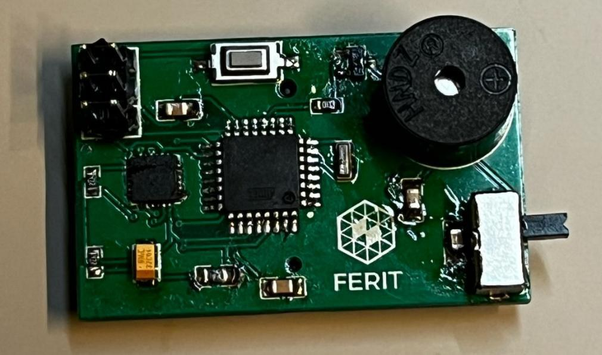
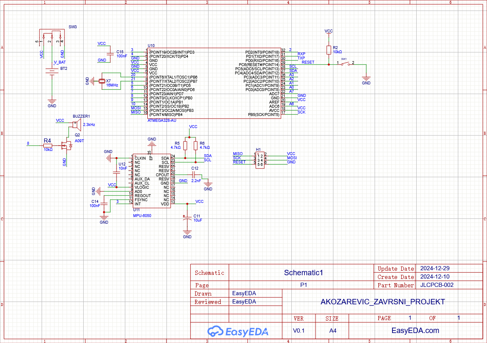
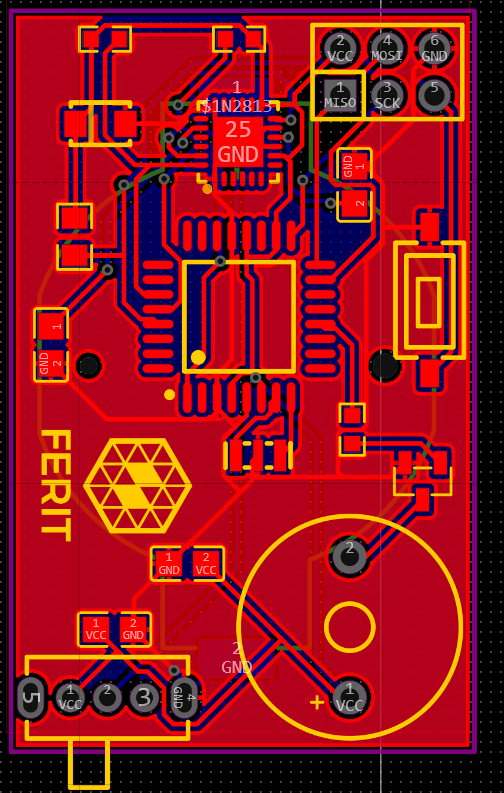
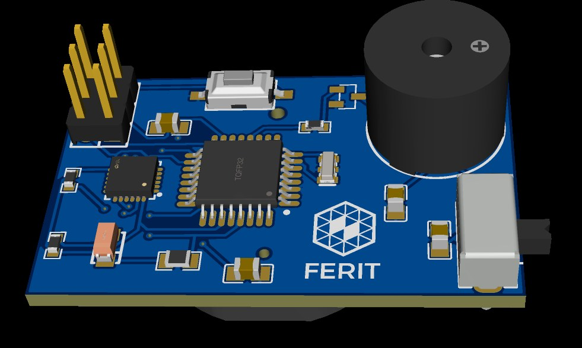

# Bike Alarm

Sigurnosni alarm za bicikl na vlastitoj tiskanoj pločici (ATmega328 + akcelerometar MPU-6050 + buzzer). Ako se bicikl pomakne, uređaj kratko oglasi upozorenje; ako se unutar 10 sekundi dogodi novi pokret, uključuje se dugi alarm.

Projekt iz kolegija *Tehnologije razvoja računalnih sustava* (FERIT Osijek, 2024/2025).
Autor: Anto Kožarević

## Kako radi

1. MPU-6050 se očitava svakih 100 ms, a prati se promjena ukupnog ubrzanja (`sqrt(ax² + ay² + az²)`) između dva očitanja.
2. **Prvi pokret** (promjena veća od praga 1000): buzzer zvuči 1 sekundu kao upozorenje.
3. **Drugi pokret u roku od 10 s**: buzzer zvuči 20 sekundi (alarm).
4. Nakon 10 s bez novog pokreta sustav se vraća u početno stanje.

Kod: [`firmware/bike_alarm/bike_alarm.ino`](firmware/bike_alarm/bike_alarm.ino)

## Hardver

Pločica je dizajnirana u EasyEDA i naručena od JLCPCB-a.

- ATmega328 (TQFP-32), kristal 16 MHz
- MPU-6050 (I²C, pull-up otpornici 4,7 kΩ)
- Buzzer 2,3 kHz upravljan MOSFET-om
- 6-pinski ISP konektor za programiranje, tipkalo za reset, prekidač napajanja

| Shema | PCB layout |
|:---:|:---:|
|  |  |

## Programiranje

ATmega328 je programiran preko ISP konektora (bez Arduino pločice), uz [MiniCore](https://github.com/MCUdude/MiniCore) podršku u Arduino IDE-u. Potrebna je biblioteka [MPU6050 (Electronic Cats)](https://github.com/ElectronicCats/mpu6050).

## Poznate greške u izradi

Opisano u izvještaju – što bi se ispravilo u sljedećoj reviziji pločice:

- Napajanje 5 V nije ispravno izvedeno, što može utjecati na rad ATmega328.
- MPU-6050 radi na 3,3 V, a ostatak sustava na 5 V – potrebno uskladiti naponske razine na I²C sabirnici.
- Buzzer je potrebno upravljati preko tranzistora s baznim otpornikom jer mikrokontroler ne može isporučiti dovoljnu struju.
- Naponskim regulatorima trebaju kondenzatori za stabilizaciju napona.

## Dokumentacija

Cjelovit izvještaj: [`docs/Izvjestaj.pdf`](docs/Izvjestaj.pdf)
